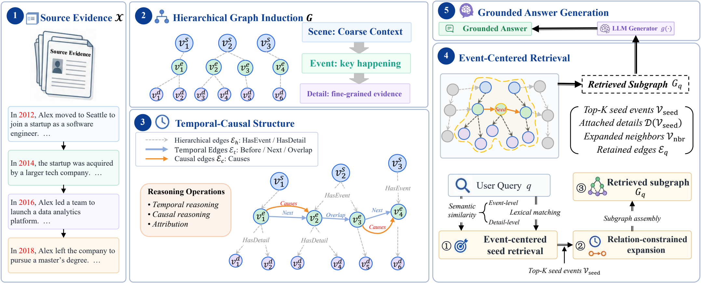

# HiTaC-Mem

**Enhancing Temporal and Causal Reasoning in Grounded LLM Systems with Hierarchical Graph Memory**

> **Code coming soon.** The implementation, evaluation scripts, and reproducibility instructions are being prepared for public release.

## Overview

HiTaC-Mem organizes source evidence into a hierarchical **scene–event–detail graph** with explicit temporal and causal relations. Event-centered retrieval and relation-constrained expansion assemble evidence subgraphs for grounded answer generation.

## Framework

The framework connects source evidence, hierarchical graph induction, temporal–causal structure, event-centered retrieval, and grounded answer generation.

## Release status

This repository currently provides the framework overview. Code and instructions for reproducing the experiments will be added here when the release is ready.
